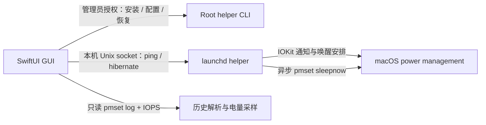

# 架构与维护边界

## 进程

GUI 与 helper 使用相同的配置、状态和通信类型，但分别编译，不使用动态代码下载或网络服务。

- `Sources/App/App.swift`：页面、管理员安装流程、服务状态、手动操作。
- `Sources/App/HistoryView.swift`：历史范围选择、图表、区间明细和 CSV。
- `Sources/Helper/Helper.swift`：策略状态机、CLI、主运行循环和控制连接。
- `Sources/Helper/CommandRunner.swift`：不重入主运行循环的、有超时的 POSIX 命令执行和本轮唤醒原因解析。
- `Sources/Helper/ScheduledWake.swift`：原生 IOPM 单次唤醒安排及取消。
- `Sources/Helper/PowerMonitor.swift`：SystemConfiguration 动态能力状态监听、能力与合盖读取。
- `Sources/Shared/Shared.swift`：路径、配置、状态、策略判断、电源读取和进程工具。
- `Sources/Shared/Control.swift`：Unix socket 地址与客户端。
- `Sources/Shared/Spawn.swift`：非阻塞子进程启动。
- `Sources/History/History.swift`：事件解析、工具请求关联、区间与历史存储。

## 版本

应用版本在 `Resources/Info.plist`；helper 协议版本在 `Shared.swift` 的 `helperProtocolVersion`。GUI 1.4.2 与 helper 协议 1.5 配套。二者不需要同步增加版本号；修改协议时需同时更新服务端、客户端与兼容策略。

## 策略流程

1. 管理员 CLI 先备份电池与接电源的 `hibernatemode`，再应用范围内的模式 3。
2. 收到系统将睡眠的 IOKit 通知后，记录睡眠开始并安排本工具自己的单次唤醒。
3. 提前唤醒或切换到不适用的供电状态，取消本轮转换。
4. 达到阈值后，合盖 DarkWake 路径通过动态能力状态立即检查：CPU on、Video off、明确合盖且供电符合范围才设置模式 25，让系统自然回睡，不调用 sleepnow。完整唤醒仍等待 25 秒并检查 HID 与用户唤醒原因。
5. 手动或完整唤醒路径设为模式 25 后，使用 `posix_spawn` 启动 `pmset sleepnow`，主循环继续处理通知与控制请求。DarkWake 路径只修改下一次睡眠模式，状态显示为请求，须在恢复后核对实际模式。
6. 唤醒后恢复模式 3，服务回到就绪状态。停用时恢复启用前的备份。

系统可能自行更早进入深度休眠；模式值不是实时硬件状态。

## 合盖后台唤醒

传统 IORegisterForSystemPower 通知不覆盖所有 DarkWake，不能把“服务仍响应”视为“到期检查已执行”。PowerMonitor 用公开 SystemConfiguration API 订阅 `State:/IOKit/SystemPowerCapabilities`，同时每秒补查，避免短暂维护唤醒在 25 秒检查前结束。此状态键和 IOPMCapability 位来自 Apple 的 IOPMLibPrivate.h/电源管理源码，键本身属于未公开稳定性承诺的系统实现；不调用 IOPMConnection 私有入口。若状态不可读则不推测，服务页显示监听未确认。

能力位使用 CPU=1、Video=2，不能混用 IORegistry 的 `System Capabilities`。合盖值来自 IOPMrootDomain 的 AppleClamshellState。下发前在非阻塞锁内再次核对能力、合盖、配置和供电；锁忙则下个 tick 重试。合盖路径没有强制 sleepnow，因此开盖竞争不会触发一次额外的强制睡眠。实际模式需恢复日志确认。

参考：[Apple IOPMLibPrivate.h](https://github.com/apple-oss-distributions/IOKitUser/blob/main/pwr_mgt.subproj/IOPMLibPrivate.h)、[Apple IOPMrootDomain.cpp](https://github.com/apple-oss-distributions/xnu/blob/main/iokit/Kernel/IOPMrootDomain.cpp)。

## 不得破坏的约束

- IOKit 睡眠通知不能同步等待 `pmset sleepnow`，不能取得可能被该请求持有的操作锁。
- 通知处理使用原生 IOPM 唤醒接口，必须及时调用 `IOAllowPowerChange`。
- 睡眠子进程异步启动，退出后由主循环 `waitpid(..., WNOHANG)` 回收。
- 操作锁用来协调 root CLI 和 daemon；通知路径避免重入该锁。
- 只取消 `local.sleepbridge.transition` 的事件，不执行全局 `schedule cancelall`。
- 备份必须先于第一次电源设置修改持久化。

过去同步等待 sleepnow 会让系统等通知、服务等系统，造成 30 秒通知超时和 IPC 失联。自动测试包含该路径的隔离回归，详见 [TESTING.md](TESTING.md)。

## 数据流与隐私

管理员安装的配置、状态和简短服务事件位于 root 拥有的 `/Library/Application Support/SleepBridge/`。普通 GUI 可读取这些文件；修改需管理员权限，或者通过受限 socket 命令。

历史数据是当前用户的 `~/Library/Application Support/SleepBridgeHistory/history.json`。GUI 每分钟导入系统保留的事件并采集当前电量，保留 90 天。退出应用不停止后台策略，但暂停分钟采样。

具体区间语义见 [HISTORY.md](HISTORY.md)，特权控制边界见 [SECURITY.md](../SECURITY.md)。

## 自动检查的重入修复

Foundation Process.waitUntilExit 会运行调用线程的 RunLoop。在持有操作文件锁时调用它，会让一秒定时器重入 reload，随后在同一文件锁上自锁。Helper 的命令执行不能使用该等待方式：使用有时间上限的 posix_spawn/poll/waitpid，耗时的日志读取放到工作队列，返回主线程后再校验周期 generation。主循环获取操作锁使用 LOCK_NB，忙时跳过或重新排队。
